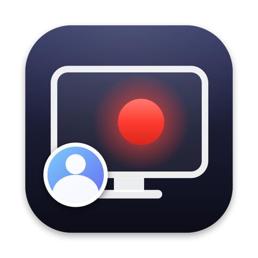

<p align="center"></p>

<h1 align="center">ScreenRecz</h1>

<p align="center">A tiny macOS menu-bar screen recorder. Screen, mic, camera and system audio, saved as one web-ready MP4.</p>

<p align="center"><a href="https://avirooppaul.github.io/screen-recz/">Website</a> · <a href="https://github.com/AviroopPaul/screen-recz/releases/latest/download/ScreenRecz.zip">Download</a></p>

## Features

- **Camera overlay**: a floating bubble you can drag anywhere, even while recording. Circle, Rounded, Square or Wide. Scroll or pinch on it to resize, right-click for options. What you see is what gets recorded.
- **Echo-free audio**: mic and system audio are mixed into one track. Apple's voice processing removes speaker sound from the mic, without ducking your other audio. Turn it off when you wear headphones.
- **Web-ready MP4**: H.264 + AAC, 1080p 30fps, fast-start. About 40 to 60 MB per 10 minutes. Saved to `~/Pictures/screen-recz`.
- **Tiny and fast**: native Swift on ScreenCaptureKit and the hardware video encoder. About 1 MB, no dependencies.
- **Discreet**: the menu bar icon just turns red while recording, with no timer. Open the menu to see the elapsed time above Stop Recording. The app's own menus are hidden from recordings.
- **Private**: no account, no network, no telemetry.

Press **⌃⌥⌘R** to start or stop recording from anywhere.

## Install

1. Download [ScreenRecz.zip](https://github.com/AviroopPaul/screen-recz/releases/latest/download/ScreenRecz.zip), unzip it and drag **ScreenRecz.app** to Applications.
2. The app isn't notarized, so macOS blocks the first launch. Open **System Settings > Privacy & Security** and click **Open Anyway**, or run:
   ```bash
   xattr -dr com.apple.quarantine /Applications/ScreenRecz.app
   ```
3. Allow Screen & System Audio Recording, Camera and Microphone when asked, then relaunch.

Requires macOS 15 or later on Apple Silicon.

## Build from source

Needs the Xcode Command Line Tools.

```bash
git clone https://github.com/AviroopPaul/screen-recz && cd screen-recz
./scripts/build.sh --install
```

`build.sh` signs with a local identity named `ScreenRecz Local Signing` when your keychain has one, so macOS keeps the app's permissions across rebuilds. Without it, it signs ad-hoc and macOS asks for permissions again after every build.

## How it works

| File | Role |
| --- | --- |
| `Recorder.swift` | ScreenCaptureKit stream into an AVAssetWriter (hardware H.264, AAC). |
| `MicCapture.swift` | Mic through AVAudioEngine voice processing for echo cancellation. |
| `Finalizer.swift` | Remuxes into the final MP4: video passthrough, mic and system audio mixed into one AAC track, fast-start. |
| `CameraOverlay.swift` | The floating camera panel. It is a real window, so the recording captures it as it is. |
| `AppDelegate.swift` | Menu bar UI, settings and the global hotkey. |

## License

[MIT](LICENSE)
